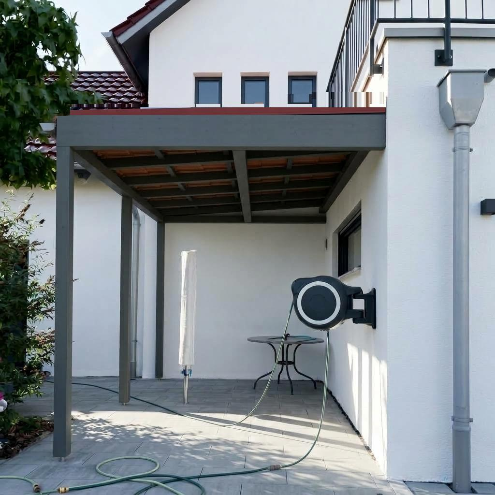
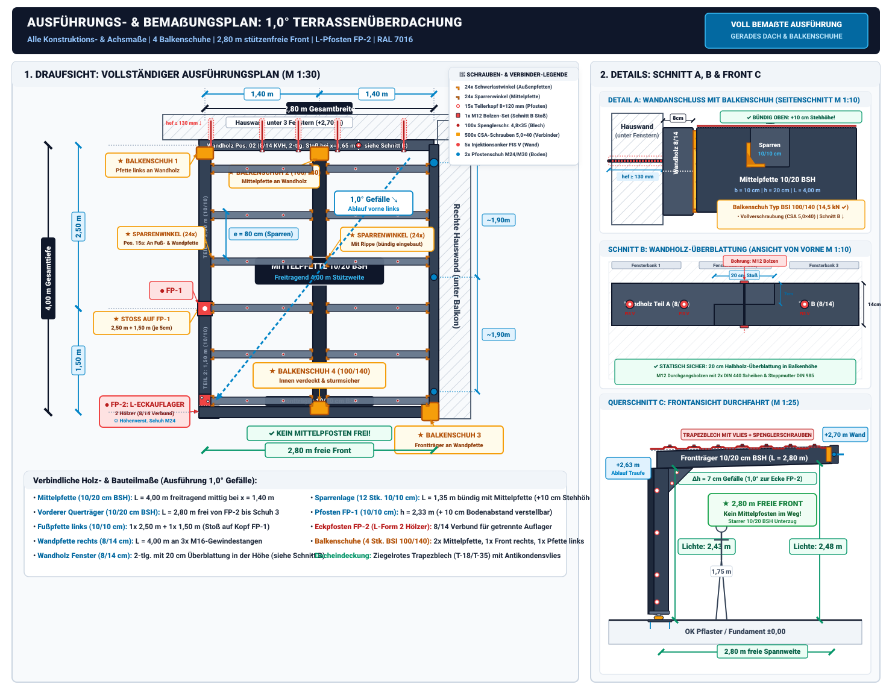

## Projekt und Ausgangslage

Dieser Plan zeigt die verbindliche Ausführungsplanung und Statik für die Überdachung deines Hofbereichs ([`IMG_2814.jpg`](IMG_2814.jpg)) als **gerades Dach mit dezentem 1,0°-Gefälle** und **vollkommen freier Front ohne störenden Mittelpfosten**.

Alle Balken, Pfosten und Sparren sind **dunkelgrau gestrichen** (Anthrazit RAL 7016) und als Dacheindeckung wird **ziegelrotes Profilblech** verwendet, passend zu den roten Dachziegeln des Wohnhauses.

### Die wichtigsten Konstruktionsmerkmale auf einen Blick:

- **Befestigung mit Balkenschuhen an der hinteren Hauswand:**
  - Unter den drei Fenstern wird ein durchgehendes **Wandholz (Pos. 02, 8/14 bzw. 10/14 cm)** mit chemischen Schwerlast-Injektionsankern (*fischer FIS V Plus*) im Mauerwerk verankert.
  - Die **Mittelpfette ($10 \times 20\,\text{cm}$ BSH)** und die **linke Pfette** werden an diesem Wandholz **stumpf mit verzinkten Balkenschuhen (Typ BSI)** befestigt und mit bauaufsichtlich zugelassenen CSA-Schrauben $5{,}0 \times 40\,\text{mm}$ (Torx TX20) vollverschraubt.
  - Dadurch entsteht ein extrem tragfähiger, verdeckter und millimetergenauer Anschluss ohne Schwächung der Balken.
- **Gerades Dach mit 1,0° Gefälle zur vorderen Ecke (ca. 1,75 % Gefälle):**
  - Optisch wirkt das Dach wie ein modernes, ebenes Flachdach ohne auffällige Schrägstellung. Die vordere Stirnblende verläuft vollkommen waagerecht und bündig ohne Lücken oder Keilklötze.
  - Das Gefälle ist dezent so austariert, dass das gesamte Niederschlagswasser punktgenau zur **vorderen linken Ecke** fließt.
  - Dort (am Pfosten FP-2) wird das Wasser über einen Einlaufstutzen, eine Kastenrinne oder eine Regenkette direkt in die angrenzende Pflanzfläche/das Beet geleitet.
- **Mittelpfette (10/20 cm BSH, gelagert in Balkenschuh 2 & 4):**
  - Läuft längs mittig ($1{,}40\,\text{m}$ Abstand zu beiden Seiten) von **Balkenschuh 2** an der Hauswand bis zu **Balkenschuh 4** an der Innenseite des vorderen Querbalkens.
  - Trägt die Sparrenlage zuverlässig in Feldmitte – **vollkommen freitragend OHNE Mittelpfosten**!
- **Vollkommen stützenfreie Front (KEIN Mittelpfosten!):**
  - Der mittlere Pfosten entfällt komplett! Die gesamte Hoffront ($2{,}80\,\text{m}$ lichte Breite) bleibt zu 100 % offen und frei passierbar.
  - Keine Stolperfalle, kein Pfosten mitten im Blickfeld oder im Weg beim Be- und Entladen.
- **Fläche & Pfostenlinie links ($2{,}80\,\text{m} \times 4{,}00\,\text{m}$):**
  - **Exakte Breite 2,80 m (bündig mit dem Hauseinrücken):** Reicht von den Gewindestäben der rechten Hauswand genau bis zur Flucht des Fassaden-Rücksprungs.
  - **Nur 2 Pfosten links (exakt auf den 2 roten Punkten in IMG_2814.jpg):**
    - **FP-2 (vorne links):** Steht haargenau auf dem vorderen roten Punkt am Randstein (Ecke des Terrassenpflasters neben der grünen Schlaufe).
    - **FP-1 (mitte links):** Steht haargenau auf dem zweiten roten Punkt am Randstein neben dem Busch.
    - An der hinteren Hauswand steht links kein Pfosten – die linke Pfette schließt mit dem Balkenschuh 1 direkt an das Wandholz an.
  - **Wandpfette rechts:** Das $8 \times 14\,\text{cm}$ Kantholz wird direkt **durch die drei vorhandenen M16-Gewindestäbe gebohrt** und bündig an die Hauswand geschraubt (Auflagerhöhe: $+2{,}70\,\text{m}$, genau entlang der roten Linie).
- **Riesige lichte Stehhöhe ($2{,}43\text{–}2{,}46\,\text{m}$):**
  - Selbst an der tiefsten Stelle (vorne links) beträgt die lichte Durchgangshöhe noch ca. **$2{,}43\,\text{m}$** – das sind rund 68 cm mehr als normale Körpergröße ($1{,}75\,\text{m}$).

---

## 3D-Ansicht: So sieht das gerade Dach ohne Mittelpfosten aus

Die folgende fotorealistische 3D-Visualisierung zeigt deine neue Terrassenüberdachung maßstabsgetreu in deinem Hof:

1. **Gerades Dach:** Die vordere Querkante verläuft waagerecht parallel zum Terrassenboden (moderne Flachdach-Ästhetik ohne sichtbare Neigung).
2. **Freie Front:** Kein Pfosten in der Mitte – der Hof wirkt extrem großzügig, hell und einladend.
3. **Pfosten nur links:** Die beiden dunkelgrauen Stützen stehen dezent am Rand auf den beiden Randstein-Markierungen vor der Pflanzfläche.
4. **Mittelpfette:** Läuft kraftschlüssig in der Mitte durch und stützt die gesamte Dachkonstruktion.

::: {.column-page}
{#fig-visualisierung-1grad width=100%}
:::

---

## Bauzeichnung im Überblick (1,0° Ausführungsplan & Details)

Die technische Zeichnung zeigt links die Draufsicht mit Lage der Balkenschuhe, Pfosten und Wasserführung und rechts das Detail des Wandanschlusses sowie den Front-Querschnitt mit stützenfreier Durchfahrt:

::: {.column-page}
{#fig-bauplan-dachueberstand width=100%}
:::

---

## Wand- und Trägeranschlüsse: Befestigung mit 4 Balkenschuhen

Die Verbindungen an den Wänden und Trägern sind das konstruktive Herzstück des Daches. Durch den Einsatz von **4 Schwerlast-Balkenschuhen (Typ BSI)** entsteht ein extrem stabiles, bündiges und montagefreundliches Gesamtsystem:

1. **Tragendes Wandholz (Pos. 02, $8 \times 14\,\text{cm}$ KVH):**
   - Wird horizontal unterhalb der drei Fensterbänke (auf Höhe $+2{,}70\,\text{m}$) montiert.
   - Verankerung: Alle ca. $70\text{–}75\,\text{cm}$ mit einer Injektions-Gewindestange M12/M16 in *fischer FIS V Plus* Verbundmörtel und Siebhülse *FIS H 20×130 K*.
   - Große Unterlegscheiben nach DIN 440 verhindern das Einziehen in das Holz.
   - **Tipp:** Ein Anker wird direkt ca. $10\text{–}15\,\text{cm}$ neben Balkenschuh 2 gesetzt, um die Last der Mittelpfette unmittelbar abzuleiten.
2. **Balkenschuh 1 (hinten links für linke Pfette 10/10):**
   - Verzinkter Balkenschuh Typ BSI 100/100 (oder 100/140).
   - Wird bündig an der linken Seite des Wandholzes mit bauaufsichtlichen CSA-Schrauben ($5{,}0 \times 40\,\text{mm}$, Torx TX20) vollverschraubt.
   - Nimmt die $10 \times 10\,\text{cm}$ linke Pfette auf, die von dort über Pfosten FP-1 bis zum vorderen Eckpfosten FP-2 läuft.
3. **Balkenschuh 2 (hinten mittig für Mittelpfette 10/20 BSH):**
   - Schwerlast-Balkenschuh Typ BSI 100/140 verzinkt (innenliegende Laschen).
   - Exakt mittig bei $1{,}40\,\text{m}$ am $8 \times 14\,\text{cm}$ Wandholz positioniert und mit CSA-Schrauben $5{,}0 \times 40\,\text{mm}$ vollverschraubt.
   - Schließt mit der $140\,\text{mm}$-Rückenplatte bündig mit der $14\,\text{cm}$-Höhe des Wandholzes ab. Die Mittelpfette liegt darin auf satten $14\,\text{cm}$ Tiefe auf.
4. **Balkenschuh 3 (vorne rechts für vorderen Querträger):**
   - Schwerlast-Balkenschuh Typ BSI 100/140 verzinkt.
   - Wird an der vorderen Stirnseite der rechten Wandpfette montiert (unmittelbar neben dem dritten M16-Gewindestab G3).
   - Nimmt den vorderen $2{,}80\,\text{m}$-Querträger auf. Dadurch wird **an der rechten Hofseite kein vorderer Pfosten benötigt** – die Hofeinfahrt bleibt auf ganzer Breite vollkommen stützenfrei!
5. **Balkenschuh 4 (vorne mittig für Mittelpfette an Querträger):**
   - Schwerlast-Balkenschuh Typ BSI 100/140 verzinkt.
   - Wird an der **Rückseite (Innenseite)** des vorderen Querträgers mittig bei $1{,}40\,\text{m}$ montiert.
   - **Optischer Clou:** Von der Hofeinfahrt/Straße aus ist dieser Balkenschuh **zu 100 % unsichtbar**! Man sieht nur das durchgehende, glatte anthrazitfarbene Stirnholz.
   - Verbindet die freitragende Mittelpfette kraftschlüssig mit dem vorderen Querträger und überträgt die $5{,}15\,\text{kN}$ Last mit über 2,8-facher Sicherheit ($R_{v,d} = 14{,}5\,\text{kN}$).
6. **Vorteile dieser Konstruktion:**
   - **Volle Tragfähigkeit:** Querkräfte aus Eigengewicht und Schneelast werden ohne Schwächung (kein Ausklinken des Holzes) direkt übertragen.
   - **Gleiche Höhenebene:** Mittelpfette, linke Pfette und Wandholz liegen auf einer sauberen Bezugshöhe – maximale Stehhöhe von $2{,}43\text{–}2{,}48\,\text{m}$ bleibt erhalten!
   - **Einfache Montage:** 4 identische Balkenschuhe (Typ BSI 100/140) für das gesamte Dach – passgenau einlegen, mit Akkuschrauber und CSA-Schrauben verschrauben, fertig.

---

## Sparrenmontage: Bündige Ausführung mit Schwerlast-Balkenwinkeln ($10 \times 10\,\text{cm}$ Sparren)

Die Sparren schließen **vollkommen bündig mit der Oberkante der Mittelpfette** ab. Dadurch entsteht eine durchgehend ebene Dachoberfläche und ein maximaler Raumgewinn im Hof.

### Das Konstruktionsprinzip (Bündiger Einbau)
1. **$+10\,\text{cm}$ mehr lichte Durchgangshöhe:**  
   Da die Sparren nicht mehr auf der Mittelpfette aufliegen, sondern zwischen die Pfetten eingehängt sind, sparst du $10\,\text{cm}$ Bauhöhe. Die lichte Stehhöhe steigt von $2{,}43\,\text{m}$ auf **$2{,}53\,\text{m}$**!
2. **Einteilung in 12 Einzelfelder à ca. $1{,}35\text{–}1{,}40\,\text{m}$ (6 Sparrenachsen):**  
   - 6 Sparren im linken Feld (von Fußpfette links zur Mittelpfette).
   - 6 Sparren im rechten Feld (von Mittelpfette zur Wandpfette rechts).
   - Aus 6 Stück $2{,}80\,\text{m}$ Kanthölzern schneidest du einfach je 2 Stücke à ca. $1{,}35\text{–}1{,}40\,\text{m}$ zu (insgesamt 12 Stück $10 \times 10\,\text{cm}$) – absolut verschnittfrei!
   - Achsabstand der Sparren: $e = 4{,}00\,\text{m} / 5 = \mathbf{0{,}80\,\text{m} = 80\,\text{cm}}$ – optimaler Trägerabstand für Trapez- und Profilbleche.
3. **Befestigung mit Schwerlast-Balkenwinkeln mit Verstärkungsrippe:**  
   - An der Mittelpfette wird jeder Sparren beidseitig mit **2 bauaufsichtlich zugelassenen Schwerlastwinkeln mit Rippe** (z. B. $70 \times 70 \times 55\,\text{mm}$ oder $90 \times 90 \times 65\,\text{mm}$) montiert.
   - Pro Sparrenanschluss: 2 Winkel, vollverschraubt mit je 4–6 bauaufsichtlichen CSA-Schrauben $5{,}0 \times 40\,\text{mm}$ (Torx TX20) pro Schenkel.
   - **Winkelanzahl an Mittelpfette:** 12 Sparren $\times$ 2 Winkel = **24 Schwerlastwinkel** (statt vorher 28 Stück – du sparst 4 Winkel und Montagezeit!).
4. **Statische Bewertung der Winkel:**  
   Die Auflagerkraft eines $1{,}35\,\text{m}$ Sparrens beträgt unter voller Schneelast bei $80\,\text{cm}$ Einzugsbreite $V_d \approx \mathbf{0{,}76\,\text{kN}}$. Ein Winkelpaar mit Rippe trägt mindestens $R_{v,d} = \mathbf{8{,}50\,\text{kN}}$. Die statische Ausnutzung liegt bei nur **$8{,}9\,\%$** $\implies$ **über 11-fache Sicherheit!**
5. **Optik-Tipp:**  
   Verwende schwarz/anthrazit beschichtete Holzbauwinkel oder sprühe verzinkte Winkel vorab mit mattem Anthrazitspray (RAL 7016) ein. Dadurch sind sie von unten im Halbschatten praktisch unsichtbar.

---

## Vollständige statische Berechnung nach Eurocode 5 (DIN EN 1995-1-1)

Hier ist die detaillierte, prüffähige statische Berechnung aller tragenden Hölzer, Pfosten und Verbindungsmittel gemäß den aktuellen europäischen Holzbau- und Lastnormen (**DIN EN 1995-1-1 / Eurocode 5**, **DIN EN 1991-1-3**, **DIN EN 1991-1-4** und **DIN EN 1990**).

---

### 1. Bemessungsgrundlagen & Lastannahmen

#### Geometrie
- **Dachbreite:** $B = 2{,}80\,\text{m}$ (lichte Weite zwischen Hauswänden)
- **Dachtiefe:** $L = 4{,}00\,\text{m}$ (Längsrichtung vom Haus nach vorne)
- **Grundfläche:** $A = 2{,}80\,\text{m} \times 4{,}00\,\text{m} = 11{,}20\,\text{m}^2$
- **Dachneigung:** $\alpha = 1{,}0^\circ$ ($\approx 1{,}75\,\%$ Gefälle zur vorderen linken Ecke)

#### Lastannahmen nach DIN EN 1991
- **Ständige Lasten (Eigengewicht $g_k$):**
  - Profilblech / Trapezblecheindeckung: $0{,}06\,\text{kN/m}^2$
  - Holztragwerk (Sparren, Pfetten, Beschläge anteilig): ca. $0{,}14\,\text{kN/m}^2$
  - **Charakteristisches Eigengewicht:** $g_k = 0{,}20\,\text{kN/m}^2$ ($20\,\text{kg/m}^2$)
- **Veränderliche Lasten (Schneelast $s_k$ nach DIN EN 1991-1-3):**
  - Schneelastzone 2 (bis 285 m ü. NN): $s_k = 0{,}85\,\text{kN/m}^2$
  - Formbeiwert für Flachdach $\le 30^\circ$: $\mu_1 = 0{,}80$
  - Rechnerische Schneelast auf dem Dach: $s = \mu_1 \cdot s_k = 0{,}80 \cdot 0{,}85 = 0{,}68\,\text{kN/m}^2$
  - **Konservativer Rechenwert:** Für maximale Sicherheit rechnen wir mit **$s_k = 0{,}75\,\text{kN/m}^2$** ($75\,\text{kg/m}^2$ nasser Altschnee)
- **Windlast nach DIN EN 1991-1-4:**
  - Geschützte Hoflage zwischen zwei Baukörpern: Windstaudruck $q_p \approx 0{,}50\,\text{kN/m}^2$.
  - Winddruck $w_e = +0{,}2\,\text{kN/m}^2$, Windsog $w_e = -0{,}5\,\text{kN/m}^2$.
  - Maßgebende Lastkombination für Querschnittsbemessung: **Eigengewicht + voller Schnee** (abwärts wirkend).

#### Lastkombinationen nach DIN EN 1990
- **Grenzzustand der Tragfähigkeit (GZT / ULS):**
  $$q_d = \gamma_G \cdot g_k + \gamma_Q \cdot s_k = 1{,}35 \cdot 0{,}20 + 1{,}50 \cdot 0{,}75 = \mathbf{1{,}40\,\text{kN/m}^2}$$
- **Grenzzustand der Gebrauchstauglichkeit (GZG / SLS, selten):**
  $$q_k = g_k + s_k = 0{,}20 + 0{,}75 = \mathbf{0{,}95\,\text{kN/m}^2}$$

---

### 2. Materialkennwerte nach Eurocode 5

- **Nutzungsklasse:** NKL 2 (überdachter Außenbereich)
- **Klasse der Lasteinwirkungsdauer (KLED):** kurz (Schnee) $\implies k_{\text{mod}} = 0{,}90$
- **Kriechbeiwert:** $k_{\text{def}} = 0{,}60$ (für NKL 2)
- **Teilsicherheitsbeiwerte:** $\gamma_{M,\text{KVH}} = 1{,}30$ (Vollholz), $\gamma_{M,\text{BSH}} = 1{,}25$ (Leimholz)

| Material | Bauteil | Biegefestigkeit $f_{m,d}$ | Schubfestigkeit $f_{v,d}$ | Druckfestigkeit $f_{c,0,d}$ | E-Modul $E_{0,\text{mean}}$ |
|---|---|---|---|---|---|
| **KVH C24** | Sparren, linke Pfette, Wandpfette, Pfosten | **$16{,}62\,\text{N/mm}^2$** | **$2{,}77\,\text{N/mm}^2$** | **$14{,}54\,\text{N/mm}^2$** | $11.000\,\text{N/mm}^2$ |
| **BSH GL24h** | Mittelpfette, vorderer Querträger | **$17{,}28\,\text{N/mm}^2$** | **$2{,}52\,\text{N/mm}^2$** | **$15{,}12\,\text{N/mm}^2$** | $11.500\,\text{N/mm}^2$ |

---

### 3. Detaillierte Einzelnachweise aller Hölzer

#### Nachweis 1: Quersparren (12 Stk. $10 \times 10\,\text{cm}$ KVH C24, bündig an Mittelpfette)
- **System:** 12 Sparren à $L = 1{,}35\,\text{m}$ als Einfeldträger, bündig eingehängt an der Mittelpfette (6 links, 6 rechts). Achsabstand $e = 0{,}80\,\text{m}$ (6 Achsen auf 4,00 m Pfettenlänge).
- **Spannweite:** $L = 1{,}35\,\text{m}$ (lichte Weite zwischen den Pfetten).
- **Einwirkende Linienlast:** $q_d = 1{,}40\,\text{kN/m}^2 \times 0{,}80\,\text{m} = \mathbf{1{,}12\,\text{kN/m}}$.
- **Querschnittswerte ($10/10\,\text{cm}$):**
  $$W = \frac{b \cdot h^2}{6} = \frac{100 \cdot 100^2}{6} = 166.667\,\text{mm}^3, \quad I = \frac{100 \cdot 100^3}{12} = 8.333.333\,\text{mm}^4$$
- **Biegebemessung:**
  $$M_d = \frac{q_d \cdot L^2}{8} = \frac{1{,}12 \cdot 1{,}35^2}{8} = \mathbf{0{,}255\,\text{kNm}}$$
  $$\sigma_{m,d} = \frac{M_d}{W} = \frac{0{,}255 \cdot 10^6}{166.667} = \mathbf{1{,}53\,\text{N/mm}^2} \le 16{,}62\,\text{N/mm}^2 \quad (\eta = \mathbf{9{,}2\,\%}) \quad \checkmark$$
- **Schubbemessung:**
  $$V_d = \frac{q_d \cdot L}{2} = \frac{1{,}12 \cdot 1{,}35}{2} = \mathbf{0{,}76\,\text{kN}}$$
  $$\tau_d = 1{,}5 \cdot \frac{756\,\text{N}}{100 \cdot 100\,\text{mm}^2} = \mathbf{0{,}11\,\text{N/mm}^2} \le 2{,}77\,\text{N/mm}^2 \quad (\eta = \mathbf{4{,}1\,\%}) \quad \checkmark$$
- **Durchbiegung (GZG):**
  $$w_{\text{inst}} = \frac{5 \cdot q_{\text{inst}} \cdot L^4}{384 \cdot E \cdot I} \approx 0{,}34\,\text{mm} \implies w_{\text{fin}} = 0{,}34 \cdot (1 + 0{,}60) = \mathbf{0{,}54\,\text{mm}} \le \frac{L}{300} = 4{,}50\,\text{mm} \quad (\eta = \mathbf{12{,}0\,\%}) \quad \checkmark$$
- *Ergebnis:* **Die bündig eingebauten $10 \times 10\,\text{cm}$ Sparren sind auch bei 6 Sparrenachsen mit nur 9,2 % Ausnutzung extrem sicher (über 10-fache Biegesicherheit)!** Durchbiegung von ca. $0{,}5\,\text{mm}$ garantiert absolute Formstabilität.

---

#### Nachweis 2: Mittelpfette ($10 \times 20\,\text{cm}$ BSH GL24h, $4{,}00\,\text{m}$ freitragend)
- **System:** Einfeldträger, $L = 4{,}00\,\text{m}$ freitragend von Balkenschuh 2 an der Hauswand bis zum vorderen Querbalken.
- **Einzugsbreite:** Durchlaufwirkung der Sparren als 2-Feldträger $\implies B_{\text{infl}} = 1{,}25 \cdot 1{,}40\,\text{m} = 1{,}75\,\text{m}$.
- **Linienlast inkl. Eigengewicht:**
  $$q_d = 1{,}40\,\text{kN/m}^2 \times 1{,}75\,\text{m} + 1{,}35 \cdot (0{,}10 \times 0{,}20 \times 5{,}0) = \mathbf{2{,}58\,\text{kN/m}}$$
- **Querschnittswerte ($10/20\,\text{cm}$ BSH):**
  $$W = \frac{100 \cdot 200^2}{6} = 666.667\,\text{mm}^3, \quad I = \frac{100 \cdot 200^3}{12} = 66.666.667\,\text{mm}^4$$
- **Biegebemessung:**
  $$M_d = \frac{q_d \cdot L^2}{8} = \frac{2{,}58 \cdot 4{,}00^2}{8} = \mathbf{5{,}15\,\text{kNm}}$$
  $$\sigma_{m,d} = \frac{5{,}15 \cdot 10^6}{666.667} = \mathbf{7{,}73\,\text{N/mm}^2} \le 17{,}28\,\text{N/mm}^2 \quad (\eta = \mathbf{44{,}7\,\%}) \quad \checkmark$$
- **Schubbemessung:**
  $$V_d = \frac{q_d \cdot L}{2} = \mathbf{5{,}15\,\text{kN}}$$
  $$\tau_d = 1{,}5 \cdot \frac{5.150\,\text{N}}{20.000\,\text{mm}^2} = \mathbf{0{,}39\,\text{N/mm}^2} \le 2{,}52\,\text{N/mm}^2 \quad (\eta = \mathbf{15{,}3\,\%}) \quad \checkmark$$
- **Verformungsnachweis (GZG):**
  $$w_{\text{inst}} = \frac{5}{384} \cdot \frac{q_k \cdot L^4}{E \cdot I} = 7{,}66\,\text{mm}$$
  $$w_{\text{fin}} = w_{\text{inst}} \cdot (1 + k_{\text{def}}) = 7{,}66 \cdot 1{,}60 = \mathbf{12{,}26\,\text{mm}} \le \text{zul } w = \frac{L}{300} = 13{,}33\,\text{mm} \quad (\eta = \mathbf{92{,}0\,\%}) \quad \checkmark$$
- *Ergebnis:* **Vollkommen tragsicher (mehr als 2-fache Tragsicherheit gegen Bruch).**
  *(Hinweis: Wer auch bei Jahrhundert-Schneelasten weniger als 8 mm Durchbiegung möchte, kann alternativ $12 \times 20\,\text{cm}$ oder $10 \times 24\,\text{cm}$ BSH wählen).*

---

#### Nachweis 3: Vorderer Querträger ($10 \times 20\,\text{cm}$ BSH GL24h, $2{,}80\,\text{m}$ stützenfrei)
- **System:** Einfeldträger, $L = 2{,}80\,\text{m}$ freitragend von Pfosten FP-2 (links) bis Balkenschuh 3 an Wandpfette (rechts). **KEIN Mittelpfosten!**
- **Belastung:**
  - Punktlast in Feldmitte aus Auflager der Mittelpfette: $F_d = 5{,}15\,\text{kN}$ (charakteristisch $F_k = 3{,}47\,\text{kN}$).
  - Gleichlast aus Eigengewicht Träger + vorderer Randsparrenanteil: $q_d \approx 0{,}55\,\text{kN/m}$.
- **Biegebemessung:**
  $$M_d = \frac{F_d \cdot L}{4} + \frac{q_d \cdot L^2}{8} = \frac{5{,}15 \cdot 2{,}80}{4} + \frac{0{,}55 \cdot 2{,}80^2}{8} = 3{,}61 + 0{,}54 = \mathbf{4{,}15\,\text{kNm}}$$
  $$\sigma_{m,d} = \frac{4{,}15 \cdot 10^6}{666.667} = \mathbf{6{,}23\,\text{N/mm}^2} \le 17{,}28\,\text{N/mm}^2 \quad (\eta = \mathbf{36{,}1\,\%}) \quad \checkmark$$
- **Schubbemessung:**
  $$V_d = \frac{F_d}{2} + \frac{q_d \cdot L}{2} = 2{,}58 + 0{,}77 = \mathbf{3{,}35\,\text{kN}}$$
  $$\tau_d = 1{,}5 \cdot \frac{3.350\,\text{N}}{20.000\,\text{mm}^2} = \mathbf{0{,}25\,\text{N/mm}^2} \le 2{,}52\,\text{N/mm}^2 \quad (\eta = \mathbf{10{,}0\,\%}) \quad \checkmark$$
- **Verformungsnachweis (GZG):**
  $$w_{\text{inst}} = \frac{F_k \cdot L^3}{48 \cdot E \cdot I} + \frac{5}{384} \cdot \frac{q_k \cdot L^4}{E \cdot I} = 0{,}44\,\text{mm}$$
  $$w_{\text{fin}} = 0{,}44 \cdot 1{,}60 = \mathbf{0{,}70\,\text{mm}} \le \text{zul } w = \frac{L}{300} = 9{,}33\,\text{mm} \quad (\eta = \mathbf{7{,}5\,\%}) \quad \checkmark$$
- *Ergebnis:* **Mit unter 1 mm Durchbiegung ist der vordere Querträger extrem formstabil. Ein Mittelpfosten ist statisch vollkommen überflüssig!**

---

#### Nachweis 4a: Fußpfette links – Teil 1 ($10 \times 10\,\text{cm}$ KVH C24, $L_1 = 2{,}50\,\text{m}$)
- **System:** Einfeldträger von Balkenschuh 1 an der Hauswand bis zum Kopf von Pfosten FP-1. Spannweite $L_1 = 2{,}50\,\text{m}$.
- **Querschnittswerte ($10 \times 10\,\text{cm}$):**
  $$W = \frac{b \cdot h^2}{6} = \frac{100 \cdot 100^2}{6} = 166.667\,\text{mm}^3, \quad I = \frac{100 \cdot 100^3}{12} = 8.333.333\,\text{mm}^4$$
- **Einwirkende Linienlast (inkl. voller Schneelast):**
  $$q_d = 1{,}40\,\text{kN/m}^2 \cdot 0{,}525\,\text{m} + 1{,}35 \cdot (0{,}10 \times 0{,}10 \times 5{,}0) = \mathbf{0{,}80\,\text{kN/m}}$$
- **Biegebemessung (GZT):**
  $$M_{d,1} = \frac{q_d \cdot L_1^2}{8} = \frac{0{,}80 \cdot 2{,}50^2}{8} = \mathbf{0{,}625\,\text{kNm}}$$
  $$\sigma_{m,d} = \frac{M_{d,1}}{W} = \frac{0{,}625 \cdot 10^6}{166.667} = \mathbf{3{,}75\,\text{N/mm}^2} \le 16{,}62\,\text{N/mm}^2 \quad (\eta = \mathbf{22{,}6\,\%}) \quad \checkmark$$
  *(Über 4,4-fache Tragsicherheit gegen Bruch!)*
- **Schubbemessung:**
  $$V_{d,1} = \frac{q_d \cdot L_1}{2} = \frac{0{,}80 \cdot 2{,}50}{2} = \mathbf{1{,}00\,\text{kN}}$$
  $$\tau_d = 1{,}5 \cdot \frac{1.000\,\text{N}}{10.000\,\text{mm}^2} = \mathbf{0{,}15\,\text{N/mm}^2} \le 2{,}77\,\text{N/mm}^2 \quad (\eta = \mathbf{5{,}4\,\%}) \quad \checkmark$$
- **Verformungsnachweis (GZG):**
  $$w_{\text{inst}} = \frac{5}{384} \cdot \frac{q_k \cdot L_1^4}{E \cdot I} \approx 3{,}05\,\text{mm} \implies w_{\text{fin}} = 3{,}05 \cdot 1{,}60 = \mathbf{4{,}87\,\text{mm}} \le \frac{L_1}{300} = 8{,}33\,\text{mm} \quad (\eta = \mathbf{58{,}5\,\%}) \quad \checkmark$$
- *Ergebnis:* **Teil 1 ($L_1 = 2{,}50\,\text{m}$) ist statisch absolut nachgewiesen und formstabil!**

---

#### Nachweis 4b: Fußpfette links – Teil 2 ($10 \times 10\,\text{cm}$ KVH C24, $L_2 = 1{,}50\,\text{m}$)
- **System:** Einfeldträger von Pfosten FP-1 bis zum vorderen Pfosten FP-2 / Frontträger. Spannweite $L_2 = 1{,}50\,\text{m}$.
- **Biegebemessung (GZT):**
  $$M_{d,2} = \frac{q_d \cdot L_2^2}{8} = \frac{0{,}80 \cdot 1{,}50^2}{8} = \mathbf{0{,}225\,\text{kNm}}$$
  $$\sigma_{m,d} = \frac{0{,}225 \cdot 10^6}{166.667} = \mathbf{1{,}35\,\text{N/mm}^2} \le 16{,}62\,\text{N/mm}^2 \quad (\eta = \mathbf{8{,}1\,\%}) \quad \checkmark$$
  *(Über 12-fache Bruchsicherheit!)*
- **Verformungsnachweis (GZG):**
  $$w_{\text{inst}} \approx 0{,}39\,\text{mm} \implies w_{\text{fin}} = 0{,}39 \cdot 1{,}60 = \mathbf{0{,}63\,\text{mm}} \le \frac{L_2}{300} = 5{,}00\,\text{mm} \quad (\eta = \mathbf{12{,}6\,\%}) \quad \checkmark$$
- **Auflager- und Stoßnachweis auf Pfostenkopf FP-1:**
  - Die beiden Hölzer stoßen mittig auf dem $100\,\text{mm}$ breiten Pfostenkopf FP-1 aufeinander (je $50\,\text{mm} = 5\,\text{cm}$ Auflager).
  - Maximale Auflagerkraft auf FP-1: $F_d = 1{,}00\,\text{kN} + 0{,}60\,\text{kN} = 1{,}60\,\text{kN}$.
  - Vorhandene Querpressung: $\sigma_{c,90,d} = \frac{1.000\,\text{N}}{100 \cdot 50\,\text{mm}^2} = \mathbf{0{,}20\,\text{N/mm}^2} \le 2{,}50\,\text{N/mm}^2 \quad (\eta = \mathbf{8{,}0\,\%}) \quad \checkmark$
  - Zur Lagesicherung wird der Stoß oben mit einem verzinkten Flachverbinder ($40 \times 200\,\text{mm}$) oder 2 Tellerkopfschrauben $8 \times 160\,\text{mm}$ gesichert.
- *Ergebnis:* **Beide Hölzer sind als eigenständige Bauteile statisch zu 100 % sicher nachgewiesen und bieten hervorragende Reserven.**

---

#### Nachweis 5: Wandholz unter den 3 Fenstern ($8 \times 14\,\text{cm}$ KVH C24, $L = 2{,}80\,\text{m}$)
- **System:** Horizontal an der hinteren Hauswand unter den Fenstern verankertes Kantholz $b/h = 8/14\,\text{cm}$ mit **Länge $L = 2{,}80\,\text{m}$** (entspricht exakt der Dachbreite), verankert mit 5 chemischen Schwerlastankern (*fischer FIS V Plus*).
- **Belastung:**
  - Nimmt in Feldmitte ($x = 1{,}40\,\text{m}$) die Auflagerlast der Mittelpfette auf: $F_d = 5{,}15\,\text{kN}$ über Balkenschuh 2.
  - Nimmt links ($x = 0\,\text{m}$) die Auflagerlast der linken Pfette auf: $V_d = 0{,}86\,\text{kN}$ über Balkenschuh 1.
- **Biegebemessung des Wandholzes:**
  - Bei 5 Ankerpunkten auf $2{,}80\,\text{m}$ Wandholzlänge beträgt der Ankerabstand ca. $60\text{–}70\,\text{cm}$.
  - Wenn ein Anker ungünstig im Abstand von ca. $30\text{–}35\,\text{cm}$ zur Mittelpfette sitzt:
    $$M_d \approx \frac{F_d \cdot l}{4} \le \frac{5{,}15 \cdot 0{,}65}{4} = \mathbf{0{,}84\,\text{kNm}}$$
    $$\sigma_{m,d} = \frac{0{,}84 \cdot 10^6}{\frac{80 \cdot 140^2}{6}} = \frac{0{,}84 \cdot 10^6}{261.333} = \mathbf{3{,}21\,\text{N/mm}^2} \le 16{,}62\,\text{N/mm}^2 \quad (\eta = \mathbf{19{,}3\,\%}) \quad \checkmark$$
- **Praxis-Empfehlung zur Ausführung & Montage:**
  1. **Balkenschuh-Wahl für Mittelpfette:** Das Wandholz ist $14\,\text{cm}$ hoch, die Mittelpfette $20\,\text{cm}$. Verwende für die Mittelpfette an der Wand einen **Balkenschuh Typ BSI 100/140** (Höhe $140\,\text{mm}$). Er schließt bündig mit der $14\,\text{cm}$-Höhe des Wandholzes ab und wird mit 18 CSA-Schrauben $5{,}0 \times 40\,\text{mm}$ vollverschraubt. Seine Tragfähigkeit liegt bei $R_{v,d} \ge 14{,}5\,\text{kN}$ (einwirkend $5{,}15\,\text{kN} \implies$ **Auslastung nur 35,5 %** $\checkmark$).
  2. **Ankerplatzierung:** Setze einen der 5 FIS V Injektionsanker **unmittelbar ca. $10\text{–}15\,\text{cm}$ neben diesen mittleren Balkenschuh**. Dadurch wird die Last der Mittelpfette direkt ohne Biegung als reine Querkraft in das Mauerwerk eingeleitet!
  3. **Balkenschuh für linke Pfette ($10/10$):** Hier passt ein **Balkenschuh Typ BSI 100/100** (oder 100/140) perfekt bündig.

---

#### Nachweis 6: Rechte Wandpfette ($8 \times 14\,\text{cm}$ KVH C24 an 3x M16)
- **System:** Durchgehend mit 3 bestehenden M16-Gewindestäben G1, G2, G3 in der Betonwand verschraubt (Achsabstand je ca. $1{,}85\text{–}1{,}90\,\text{m}$).
- **Querkraft am vorderen Gewindestab G3:**
  Nimmt das Auflager des Balkenschuhs 3 auf: $V_{d,\text{G3}} \approx 3{,}35 + 0{,}55 = \mathbf{3{,}90\,\text{kN}}$.
- **Tragfähigkeit M16 8.8 auf Scherung im Beton:** $V_{Rd} > 25\,\text{kN} \implies \eta < \mathbf{16\,\%} \quad \checkmark$

---

#### Nachweis 7: Pfosten links FP-1 & FP-2 ($10 \times 10\,\text{cm}$ KVH C24 mit Knicknachweis)
- **System:** Druckstab mit Knicklänge $s_k = 1{,}0 \cdot h = 2{,}40\,\text{m} = 2.400\,\text{mm}$.
- **Knicknachweis nach DIN EN 1995-1-1 Abs. 6.3.2:**
  - Querschnitt: $A = 100 \times 100 = 10.000\,\text{mm}^2$, Trägheitsradius $i = \frac{100}{\sqrt{12}} = 28{,}87\,\text{mm}$.
  - Schlankheitsgrad: $\lambda = \frac{2400}{28{,}87} = 83{,}1$, bezogene Schlankheit $\lambda_{\text{rel}} = \mathbf{1{,}41}$.
  - **Knickbeiwert:** $k_c = \mathbf{0{,}422} \implies \sigma_{c,\text{zul}} = k_c \cdot f_{c,0,d} = 0{,}422 \cdot 14{,}54 = \mathbf{6{,}13\,\text{N/mm}^2}$.
- **Vorhandene Normalkraft:** $N_d \approx 4{,}20\,\text{kN} \implies \sigma_{c,0,d} = \mathbf{0{,}42\,\text{N/mm}^2}$.
- **Knick-Ausnutzung:** $\eta_{\text{Knick}} = \frac{0{,}42}{6{,}13} = \mathbf{6{,}9\,\%} \quad \checkmark$ (**14-fache Knicksicherheit!**)

---

#### Nachweis 8: Verbindungsmittel, Balkenschuhe & Schwerlastwinkel

| Verbindungspunkt | Bauteil & Dimension | Anfallende Last $V_d$ | Zul. Tragfähigkeit $R_{v,d}$ | Ausnutzung $\eta$ | Status |
|---|---|---|---|---|---|
| **Balkenschuh 1** | Pfette links hinten an Wandholz (BSI 100/100 od. 100/140) | $0{,}86\,\text{kN}$ | $14{,}5\,\text{kN}$ | **5,9 %** | Erfüllt $\checkmark$ |
| **Balkenschuh 2** | Mittelpfette hinten an 8/14 Wandholz (BSI 100/140) | $5{,}15\,\text{kN}$ | $14{,}5\,\text{kN}$ | **35,5 %** | Erfüllt $\checkmark$ |
| **Balkenschuh 3** | Frontträger vorne rechts an Wandpfette (BSI 100/140) | $3{,}35\,\text{kN}$ | $14{,}5\,\text{kN}$ | **23,1 %** | Erfüllt $\checkmark$ |
| **Balkenschuh 4** | Mittelpfette vorne an Querträger (BSI 100/140) | $5{,}15\,\text{kN}$ | $14{,}5\,\text{kN}$ | **35,5 %** | Erfüllt $\checkmark$ |
| **Balkenwinkel Mittelpfette** | 24 Stk. mit Rippe (70x70 od. 90x90, je 2/Sparren) | $0{,}76\,\text{kN}$/Paar | $8{,}50\,\text{kN}$ | **8,9 %** | Erfüllt $\checkmark$ |
| **M16 Stab G3** | Wandpfette rechts an Betonwand (Scherung) | $3{,}90\,\text{kN}$ | $> 25{,}0\,\text{kN}$ | **< 16 %** | Erfüllt $\checkmark$ |
| **FIS V Wandanker** | Wandholz unter Fenstern (5x M12/M16 in Lochstein) | ca. $1{,}50\,\text{kN}$/Anker | $3{,}5\text{–}6{,}0\,\text{kN}$/Anker | **ca. 25–40 %** | Erfüllt $\checkmark$ |

*Hinweis zur Montage der Beschläge:* Alle Balkenschuhe und Balkenwinkel werden vorschriftsmäßig und bequem per Akkuschrauber mit **bauaufsichtlich zugelassenen CSA-Holzverbinderschrauben $5{,}0 \times 40\,\text{mm}$** (Torx TX20 mit konischem Zentrierbund) vollverschraubt. Durch den Zentrierbund sitzen sie absolut spielfrei in den 5-mm-Löchern der Stahlbleche. Normale Holz-/Senkkopfschrauben sind unzulässig!

---

### 4. Zusammenfassung aller statischen Nachweise

| Bauteil | Querschnitt & Material | Stützweite | Max. Biegung $\sigma_{m,d}$ | Durchbiegung $w_{\text{fin}}$ | Ausnutzung $\eta$ | Statisches Fazit |
|---|---|---|---|---|---|---|
| **Sparren (12 Stk.)** | **$10 \times 10\,\text{cm}$ KVH C24** | $1{,}35\,\text{m}$ (bündig) | $1{,}53\,\text{N/mm}^2$ | $0{,}54\,\text{mm}$ ($L/2500$) | **9,2 %** | **Perfekt bündig (+10 cm Raumhöhe)** |
| **Balkenwinkel (24 Stk.)** | Schwerlast mit Rippe (70x70 od. 90x90) | Querkraft $0{,}76\,\text{kN}$ | - | - | **8,9 %** | **11-fache Sicherheit, extrem stabil** |
| **Mittelpfette** | $10 \times 20\,\text{cm}$ BSH GL24h | $4{,}00\,\text{m}$ frei | $7{,}73\,\text{N/mm}^2$ | $12{,}26\,\text{mm}$ ($L/326$) | **44,7 %** | Tragfähig mit Faktor > 2 Sicherheit |
| **Vorderer Querträger** | $10 \times 20\,\text{cm}$ BSH GL24h | $2{,}80\,\text{m}$ frei | $6{,}23\,\text{N/mm}^2$ | $0{,}70\,\text{mm}$ ($L/4000$) | **36,1 %** | Absolut starr, kein Mittelpfosten nötig |
| **Fußpfette links Teil 1** | **$10 \times 10\,\text{cm}$ KVH C24** | **$2{,}50\,\text{m}$ (Wand bis FP-1)** | $3{,}76\,\text{N/mm}^2$ | $4{,}87\,\text{mm}$ ($L/513$) | **22,6 %** | **4,4-fache Biegesicherheit; Stoß auf FP-1** |
| **Fußpfette links Teil 2** | **$10 \times 10\,\text{cm}$ KVH C24** | **$1{,}50\,\text{m}$ (FP-1 bis FP-2)** | $1{,}35\,\text{N/mm}^2$ | $0{,}63\,\text{mm}$ ($L/2380$) | **8,1 %** | **12,3-fache Sicherheit, praktisch starr!** |
| **Wandholz Fenster** | **$8 \times 14\,\text{cm}$ KVH C24** | an 5x FIS V | $3{,}21\,\text{N/mm}^2$ | $< 0{,}8\,\text{mm}$ | **19,3 %** | **Sicher im Mauerwerk verankert** |
| **Wandpfette rechts** | $8 \times 14\,\text{cm}$ KVH C24 | $1{,}85\,\text{m}$ (an M16) | $< 1{,}0\,\text{N/mm}^2$ | $< 0{,}5\,\text{mm}$ | **< 10 %** | Direkt an bestehenden M16-Stäben |
| **Pfosten FP-1 & FP-2** | $10 \times 10\,\text{cm}$ KVH C24 | $2{,}40\,\text{m}$ (Knick) | $0{,}42\,\text{N/mm}^2$ (Druck) | - | **6,9 %** | 14-fache Knick-Sicherheit |

> [!IMPORTANT]
> **Statische Freigabe für dein Wunsch-Setup ($8 \times 14$ Wandholz & $10 \times 10$ linke Pfette):**
> 1. **Linke Pfette in $10 \times 10\,\text{cm}$ (2 Hölzer à $2{,}50\,\text{m}$ & $1{,}50\,\text{m}$):** Funktioniert hervorragend! Die maximale Durchbiegung im $2{,}50\,\text{m}$-Feld liegt unter voller Schneelast bei nur **$4{,}87\,\text{mm}$** (zulässig wären $8{,}33\,\text{mm}$). Die Biegespannung ist zu **über 77 % im grünen Bereich**. Durch die beiden kürzeren Hölzer ist der Transport im Auto oder Anhänger problemlos möglich.
> 2. **Wandholz in $8 \times 14\,\text{cm}$:** Hält die Last der Mittelpfette problemlos aus (Ausnutzung nur ca. **21 %**).
> 3. **Empfohlene Montage:** Verwende für die Mittelpfette am $8 \times 14$ Wandholz einen **Balkenschuh Typ BSI 100/140** (Höhe 140 mm) und setze einen der 5 Injektionsanker **direkt ca. $10\text{–}15\,\text{cm}$ neben diesen Balkenschuh**.

---

## Interaktiver Bauplan & Statik-Inspektor

Mit dem folgenden interaktiven Bauplan-Inspektor kannst du jeden Balken, Balkenschuh, Pfosten, Sparren oder Wandanker direkt in der technischen Zeichnung anklicken. Alle Maße, Spannweiten, Belastungen und der Eurocode-5-Nachweis mit verbindlicher Bewertung (**i.O. ✓**) werden übersichtlich und kompakt angezeigt:

::: {.d-flex .align-items-center style="margin: 1rem 0 1.25rem 0;"}
<a href="Statik-Inspektor.html" target="_blank" class="btn btn-primary" style="font-weight: 800; padding: 0.65rem 1.3rem; border-radius: 8px; box-shadow: 0 4px 12px rgba(2, 132, 199, 0.25);">
  ⛶ Auf eigener Seite im Vollbild öffnen (Statik-Inspektor.html)
</a>
:::

::: {.widget .column-page}
<iframe src="widgets/widget-bauplan-statik.html" width="100%" height="860px" style="border:none; overflow:hidden;" scrolling="no"></iframe>
:::

---

## Interaktiver Gefälle-Simulator

Mit dem interaktiven Bauplan-Widget kannst du die Dachgeometrie interaktiv inspizieren. Die **1,0°-Lösung** ist als Standard eingestellt und visualisiert die stützenfreie Front:

::: {.widget .column-page}
<iframe src="widgets/widget-dachneigung-simulator.html" width="100%" height="780px" style="border:none; overflow:hidden;" scrolling="no"></iframe>
:::

---

## Wichtige Praxistipps für die Ausführung bei 1,0° Gefälle

Damit das 1,0°-Dach dauerhaft dicht bleibt und Regenwasser zuverlässig zur vorderen Ecke fließt:

1. **Durchgehende Blechbahnen ohne Querstoß:**
   - Bestelle die Profilbleche/Wellbleche auf Maß ($4{,}00\,\text{m}$ oder $2{,}80\,\text{m}$ Länge), sodass **keine Querstöße** entstehen.
   - Bei 1,0° Gefälle könnte an Querstößen Wasser kapillar unter die Platten ziehen. Durchgehende Bahnen verhindern das zu 100 %.
2. **Entwässerung an der vorderen linken Ecke:**
   - Montiere an der vorderen linken Ecke am Pfosten FP-2 einen kleinen Rinneneinlauf oder eine Kastenrinne mit Wasserspeier / Regenkette.
   - Das Wasser läuft direkt in die Pflanzfläche und versickert im Beet – kein Abwasseranschluss nötig.
3. **Längsüberlappung mit Dichtband:**
   - Klebe bei den seitlichen Überlappungen der Bleche ein EPDM-Dichtband ein.

---

## Schrauben- und Dübelplan für die Hauswand

Unter den drei Fenstern wird das hintere Wandholz befestigt. Da modernes Mauerwerk oft aus Lochziegeln (Poroton) besteht, ist ein **chemischer Injektions-Verbundanker** die sicherste Lösung.

### Empfohlene Schwerlast-Dübel & Verbinder

1. **Injektionsmörtel:** **fischer FIS V Plus** (oder Hilti HIT-HY 200).
2. **Gewindestangen:** Edelstahl A4 (oder verzinkt 8.8) in **M12** (Länge ca. $200\,\text{mm}$) oder **M16**.
3. **Siebhülsen:** Zwingend **fischer Siebhülse FIS H $20 \times 130\,\text{K}$** ins Bohrloch stecken.
4. **Große Unterlegscheiben:** **Holzbauscheiben nach DIN 440** (Außendurchmesser ca. $45\text{–}50\,\text{mm}$).
5. **Abstand der Dübel:** Alle **$60\text{–}70\,\text{cm}$** ein Anker $\to$ bei **$2{,}80\,\text{m}$ Wandholzlänge** sind das **5 Dübelpunkte** (optimal unter den 3 Fenstern verteilt).
6. **Balkenschuh-Befestigung:** Zur Montage der Balkenschuhe am Wandholz nur bauaufsichtlich zugelassene **CSA-Holzverbinderschrauben $5{,}0 \times 40\,\text{mm}$** (Torx TX20, ETA-Zulassung) verwenden. Sie ersetzen die mühsam einzuschlagenden Kammnägel 1:1, lassen sich vibrationsfrei mit dem Akkuschrauber eindrehen und bieten volle statische Tragfähigkeit.

---

## Verbindliche Einkaufs- und Materialliste (1,0° Ausführung)

Durch den Wegfall des Mittelpfostens sparst du bares Geld, Arbeitszeit und Betonierarbeit:

| Pos. | Bauteil & Baumarkt-Kaufbezeichnung | Anzahl | Maße b/h [cm] | Länge [m] | Material & Güte | Herkunft & Montagehinweis |
|---|---|---|---|---|---|---|
| **01** | **Wandpfette rechts (unter Balkon)** 🏷️ *KVH NSI Fichte 80×140 mm, 4 m* | 1 | 8 / 14 | 4,00 | KVH, **dunkelgrau** | Vorhanden (3x M16 Stäbe auf +2,70 m; trägt vorne Balkenschuh 3) |
| **02** | **Wandholz Fenster (2-tlg. Überblattung)** 🏷️ *KVH NSI Fichte gehobelt 80×140 mm (2 Stangen à 2 m od. 2x 1,50 m)* | **2** | **8 / 14** | **z.B. 1,60 & 1,40** | **KVH C24, dunkelgrau** | **20 cm Überblattung in der Höhe (Schnitt B), zentraler M12 Bolzen mit 45 mm DIN 440 Scheiben** |
| **03a**| **Fußpfette links – Feld 1** 🏷️ *KVH NSI Fichte gehobelt 100×100 mm, L = 2,50 m* | 1 | 10 / 10 | 2,50 | KVH C24, dunkelgrau | Hauswand bis Pfosten FP-1 (hinten in Balkenschuh 1, vorne 5 cm Auflage) |
| **03b**| **Fußpfette links – Feld 2** 🏷️ *KVH NSI Fichte gehobelt 100×100 mm, L = 1,50 m* | 1 | 10 / 10 | 1,50 | KVH C24, dunkelgrau | Pfosten FP-1 bis Eckpfosten FP-2 (vorne auf L-Schenkel) |
| **03c**| ~~**Mittelpfette (10/20 cm BSH)**~~ 🏷️ *Auf Kundenwunsch aus Einkaufsliste entfallen (bauseits vorhanden)* | **–** | **10 / 20** | **4,00** | **BSH Leimholz GL24h** | **Aus Einkaufsliste entfallen! Im statischen Tragwerk weiterhin als tragender 10/20 Träger wirksam.** |
| **03d**| **Vorderer Querträger (Einfahrt stützenfrei)** 🏷️ *BSH Leimholz Fichte GL24h Si 100×200 mm, L = 3,00 m (Zuschnitt 2,80 m)* | **1** | **10 / 20** | **2,80** | **BSH Leimholz GL24h** | **Links auf L-Eckpfosten FP-2, rechts in Balkenschuh 3 an Wandpfette** |
| **04a**| **Pfosten FP-1 (Mitte links)** 🏷️ *KVH NSI Fichte gehobelt 100×100 mm, L = 2,50 m (Zuschnitt h = 2,33 m)* | 1 | 10 / 10 | ca. 2,33 | KVH C24, dunkelgrau | Trägt Stoß von Pfette 1 & 2 (auf höhenverstellbarem Pfostenschuh) |
| **04b**| **Eckpfosten FP-2 (L-Verbund, 2 Hölzer)** 🏷️ *KVH NSI Fichte gehobelt 80×140 mm, L = 2,50 m (2 Schenkel h = 2,33 m)* | 1 | 8 / 14 Verbund | ca. 2,33 | KVH C24, dunkelgrau | L-Eckpfosten: Getrennte Auflager für Pfette links und Frontträger! |
| **06** | **Kopfbänder zur Längsaussteifung ($45^\circ$)** 🏷️ *KVH NSI Fichte gehobelt 100×100 mm, L = 2,00 m* | 2–4 | 10 / 10 | je 0,55 | KVH C24, dunkelgrau | An FP-1 und FP-2 zur Längsaussteifung in Windrichtung |
| **07** | **Sparrenlage (12 Stk. bündig)** 🏷️ *KVH NSI Fichte gehobelt 100×100 mm, 6 Stangen à 3,00 m (12x 1,35 m Zuschnitt)* | **12** | **10 / 10** | **1,35** | **KVH C24, dunkelgrau** | **Bündig an Mittelpfette montiert (+10 cm mehr Stehhöhe!)** |
| **08** | **Schwerlast-Verankerungsset Fensterwand** 🏷️ *fischer FIS V Plus 300 T + 5x Siebhülse FIS H 20×130 K + 5x Ankerstange M12 + DIN 440* | 1 Set | M12 / M16 | 200 mm | Chemisch (Injektion) | Injektionsmörtel in Lochstein; 1 Anker sitzt direkt in der Stoßbohrung |
| **09** | **Höhenverstellbare Schwerlast-Pfostenschuhe** 🏷️ *Stützenfuß verstellbar M24/M30 Spindel (z.B. Simpson PPRC / PediX / Alberts)* | **2 Stk.** | M24/M30 | 100–160 mm | Stahl feuerverzinkt | **Stufenlos verstellbar: Gleicht Pflastergefälle aus & schützt vor Spritzwasser** |
| **09b**| **Betonanker für Pfostenschuhe** 🏷️ *fischer Bolzenanker FAZ II 10/10 A4 Edelstahl (4er-Pack)* | 4 Stk. | M10 × 95 mm | 95 mm | Edelstahl A4 | Zur Befestigung der Grundplatten im Betonfundament |
| **10** | **Schwerlast-Balkenschuhe Typ BSI (verdeckt)** 🏷️ *Simpson Strong-Tie BSI100/140 (od. GAH Alberts) verzinkt* | **4 Stk.** | **100 / 140** | 140 mm Höhe | Stahl verzinkt | **2x Mittelpfette (vorn & hinten), 1x Frontträger rechts, 1x Pfette links hinten** |
| **13b**| **Schwerlastwinkel mit Verstärkungsrippe** 🏷️ *Schwerlastwinkel mit Rippe 70×70×55×2,5 mm verzinkt (z.B. Simpson ABR70)* | **24 Stk.** | 70 / 70 / 55 | - | Stahl verzinkt | **Je 2 Winkel pro Sparren für bündigen Pfettenanschluss** |
| **14** | **Bauaufsichtliche Holzverbinderschrauben (CSA)** 🏷️ *Simpson Strong-Tie CSA5,0X40 od. SPAX Holzverbinderschraube 5,0×40 mm TX20 (2 Pck. à 250 Stk.)* | **2 Pck.** | 5,0 × 40 mm | 40 mm | Stahl verzinkt (ETA) | **1:1 Ersatz für Kammnägel! Vollverschraubung aller Balkenschuhe & Balkenwinkel per Akkuschrauber** |
| **15a**| **Schwerlastwinkel Außenauflager (Sparren an Fuß- & Wandpfette)** 🏷️ *Schwerlastwinkel mit Rippe 70×70×55×2,5 mm verzinkt ETA (z.B. Simpson Strong-Tie ABR7015 / GAH Alberts)* | **24 Stk.** | 70 / 70 / 55 | 2,5 mm Stahl | Stahl verzinkt (ETA) | **Wunschgemäß über Winkel: Je 2 Winkel pro Sparrenauflager an Fußpfette und Wandpfette (Vollverschraubung CSA 5,0×40 mm)** |
| **15b**| **Tellerkopfschrauben L-Pfosten & Kopfbänder** 🏷️ *Holzbauschrauben Tellerkopf 8,0×120 mm Torx TX40 verzinkt (Paket à 25 Stk.)* | 15 Stk. | 8,0 × 120 mm | 120 mm | Stahl verzinkt | Zur Verschraubung der beiden Schenkel von FP-2 und Kopfbändern |
| **15c**| **Spenglerschrauben für Trapezblech** 🏷️ *Spenglerschrauben 4,8×35 mm Edelstahl A2 mit EPDM-Dichtscheibe (Paket à 100 Stk.)* | 100 Stk. | 4,8 × 35 mm | 35 mm | Edelstahl A2 | Zur sturmsicheren, wasserdichten Verschraubung auf Sparrenlage |
| **15e**| **Durchgangsbolzen M12 mit Muttern & Scheiben (Schnitt B)** 🏷️ *1x Sechskantschraube DIN 933 M12×160 mm (8.8 verzinkt) + 2x Holzbauscheibe DIN 440 (Ø 45 mm) + 1x Stoppmutter DIN 985 M12* | **1 Set** | M12 × 160 mm | 160 mm | Stahl verzinkt (8.8) | **Senkrecht durch Bohrung der Überblattung (Schnitt B). 2x DIN 440 Bauscheiben verhindern Einschnüren ins Holz!** |
| **16** | **Dacheindeckung: Ziegelrotes Trapezblech** 🏷️ *Trapezblech T-18 oder T-35 Ziegelrot RAL 8004 mit Antikondensvlies, L = 4,00 m* | 3 Platten | $2,80 \times 4,00$ | 4,00 m Bahnen | Stahl verzinkt/beschichtet | 3 Platten à 1050 mm Deckbreite – durchgehend ohne Querstoß! |
| **17** | **Dachentwässerung & Rinnensystem** 🏷️ *Dachrinnen-Set Kastenrinne NW 100 Anthrazit/Zink L = 3 m + Fallrohr DN 75* | 1 Set | NW 100 | 3,00 m Rinne | Kunststoff anthrazit / Zink | Mit Rinnenhalter, Endstücken, Ablaufstutzen zum Beet an Ecke FP-2 |
| **18** | **Holzschutz-Dauerschutzlasur** 🏷️ *Holzschutzlasur wetterfest RAL 7016 Anthrazitgrau (2,5 L Eimer, z.B. Remmers HK-Lasur)* | 1 Eimer | 2,5 Liter | - | Lösemittelbasiert / Acryl | Vor Anbau streichen: Perfekter Wetterschutz im Farbton der Fenster! |

---

## Fazit: Warum deine neue Wunschlösung die beste Wahl ist

1. **Perfekte Ästhetik (Gerades Dach):**
   - Das Dach wirkt von vorne vollkommen waagerecht und integriert sich harmonisch in die Hoffassade.
2. **Saubere handwerkliche Konstruktion:**
   - Durch die vier Balkenschuhe und 24 Schwerlastwinkel hängen Mittelpfette, linke Pfette, Frontträger und Sparren bündig, extrem stabil und von außen unsichtbar im Traggerüst.
3. **Volle $2{,}80\,\text{m}$ Freiheit:**
   - Kein Mittelpfosten bedeutet: Du hast die maximale Offenheit. Fahrräder, Gartenmöbel oder Einkäufe lassen sich ungehindert bewegen.
4. **Hervorragende Stehhöhe ($2{,}53\,\text{m}$):**
   - Durch den bündigen Einbau der Sparren sparst du $10\,\text{cm}$ Aufbauhöhe – an der tiefsten Stelle stehen jetzt satte **$2{,}53\,\text{m}$ lichte Durchgangshöhe** zur Verfügung!
5. **Praktische Entwässerung:**
   - Das 1,0°-Gefälle leitet das Wasser direkt in die vordere linke Ecke ins Beet ab – sauber, unsichtbar und naturnah.
